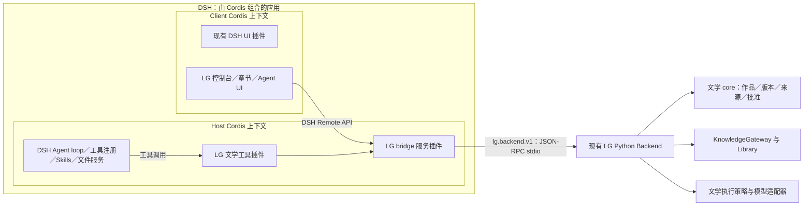

# LiteraryGiant 接入 DSH：模块职责与最小接口

核对日期：2026-11-07。DSH 基线：`fcc0ad462172522aaf5c93a7b2e01f6b9f0b0159`，`0.2.2-rc.1`；Cordis `4.1.0`。

本文保留最初模块盘点与过渡接入方案。作者随后决定将文学能力直接迁移为独立 DSH 插件；当前实现与验收以 [插件迁移](dsh-plugin-migration.md)为准。下文出现的 bridge、旧 Python 后端长期保留等建议不再是执行方案。现有 `LiteraryAgent` 工作树含未提交实现，本清单按本机代码盘点，不代表这些能力均已提交或发布。

当前方向是以 DSH / Cordis 为新主框架，逐项替换原 Core 和迁移文学逻辑。新 lg-books、lg-dashboard、lg-workbench、lg-agents、lg-execution 路径不调用旧 Core 或 Python Backend；完整迁移尚未完成。

## 1. 总体关系

Cordis 是 DSH 的组合与生命周期框架。Host 和浏览器 Client 各自运行插件上下文，通过服务依赖、注册接口和生命周期组合能力；它不是一个排在其他业务模块上方的普通功能插件。

DSH 的 Agent、默认 agent loop、工具、文件系统、Skills、会话和 UI 等能力由具体插件提供。它们不是不可替换的单体 core，但替换必须满足消费者依赖的服务契约、作用域、事件及持久化语义。一个 npm 包、一个 bundle、一行 Loader 插件、一个 service、一个模型 tool、一个 Skill 不是同一个概念。

这是接入建议，不是已实现连线。UI 与工具共用一个 bridge；Python 业务代码无需先翻写成 TypeScript，也不必直接运行在 Cordis 内。

## 2. 八类职责

这些是产品职责分类，不要求立即建立八个 npm 包。

| 类别 | 负责什么 | 现有 LG 对应实现 | 对外协作接口 | 不应承担什么 |
|---|---|---|---|---|
| 控制台／工作台 | 当前作品与会话、任务进度、结果、错误、取消、审批入口 | `lg-desktop`、`lg-vscode/webview`、`SessionStore`、`LiteraryBackend` | `book/dashboard`、`session/snapshot`、`events/read`、`run/cancel`、`operation/read` | 不决定正文是否正式采用，不在 UI 重写流程规则 |
| 章节编辑与审阅 | 正文读取、作者编辑与保存、选区、版本对比、审读意见、候选采用入口 | `manuscript_view.py`、`novel_editor.py`、现有桌面正文面板 | `manuscript/read/save/create`、`task/preview/start`、`creative/apply` | 不以通用文件覆盖替代带版本保存；不能把生成候选直接当正文 |
| Agent 设置与使用 | 总 Agent／策划／写作者／编辑的职责、会话归属、模型与工具配置展示、协作入口 | `agent_sessions.py`、`agent_runtime.py`、会话与配置模块 | `session/create/update/list/search`；未来映射 DSH preset、subagent | Agent 的人设不等于执行策略；不能靠提示词充当权限检查 |
| 文学工具与方法 | 向模型提供有明确输入输出的文学能力，如知识检索、故事读取、生成候选、灵感与规划操作 | `studio_operations.py`、`native_tools.py`、`narrative_execution.py`、`story_workflow.py` | `studio/preview/call`、`narrative/preview/run`、`task/*` 等，经白名单包装为 DSH tools | 不把整个 Backend RPC 无限制暴露给模型；方法说明可放 Skill，状态校验由代码完成 |
| Library／知识访问 | 文学知识检索、作品资料导航、来源与检索层级、受限上下文组装 | `knowledge.py`、`knowledge_catalog.py`、`workspace_library.py`、`story_context.py` | 全局知识：`knowledge/catalog/search`；作品资料：`library/list/read/actionContext` | 不把知识库与作品状态混成一个文件目录；不把整库塞入提示词 |
| 文学 core | 作品、章节、场景、版本、人物与设定事实、候选、来源、正式状态及一致性约束 | `project_store.py`、`generation_sources.py`、故事决策／审阅与来源检查模块 | 第一阶段通过现有 Backend 的受校验方法访问；内部 `ProjectStore` 是状态权威之一 | 不承担通用聊天循环、UI 排版或插件市场；不让多个 UI 各自维护另一份正式状态 |
| 文学执行策略 | 如何完成具体文学任务：准备上下文、选模型、限制调用次数、阶段推进、等待作者选择、检查旧版本、取消与恢复 | `literary_tasks.py`、`story_workflow.py`、`workflow_runner.py`、`task_scope.py`、`intent_router.py` | `task/preview/start/read/advance/select`、`workflow/*`；结果携带 task/run 标识与来源 | 不负责绘制控制台；不自行提升 Canonical 或模拟作者批准 |
| runtime／桥接与基础设施 | 进程生命周期、RPC、会话与运行映射、事件传输、超时取消、模型适配 | `backend_stdio.py`、`backend.py`、`execution_adapter.py`、`native_runtime.py`、`codex_runtime.py` | `initialize`、`protocol/schema`、`runtime/identity`、`events/read`；DSH 侧新增 bridge service | 不往通用消息分发器持续堆文学判断；不同时运行两个互相递归的通用 Agent loop |

模型与工具配置的“未来映射”不是当前已有的 DSH 设置接口。现有 LG 桌面 README 也明确完整模型管理尚未加入。

## 3. 三个容易混淆的边界

**文学 core 是“什么能成为正式作品状态”。** 例如候选是否来自当前版本、事实是否有来源、作者是否批准。迁移 UI 和 Agent loop 不应改变这些判断。

**执行策略是“这一次任务怎样完成”。** 例如选区润色限定一次调用；章节创作遇到情节分歧先给选项，等待作者选择后再写。现有 `literary_tasks.py` 已有 `polish`／`chapter` 两条有界任务，不必把它们重新藏进长提示词。

**文学工具是“把某项能力给模型调用”。** 工具负责参数契约与服务调用；业务规则仍由实际操作执行处保证。Skills 可以描述审读方法、写作流程、工具使用方式，不能代替可执行的版本检查和批准。

`runtime` 一词也应限定：DSH 的通用 Agent loop 负责通用对话与工具循环；LG 的文学任务 runtime 负责特定创作流程。初期可以让 DSH 调用一个有界 LG 任务，但不要让 DSH loop 嵌套启动 LG 的完整聊天 loop，再让后者回调 DSH loop。

## 4. Library 要分成两种接口

1. **文学知识库**：`KnowledgeGateway` 经 AbstractLibrary、作品自定义参考、BridgeIndex 等层次检索，显式允许后才访问 TaciturnRaw。通过 `knowledge/*` 提供目录、检索结果及来源。
2. **当前作品资料**：人物、章节、时间线、世界观、待审候选、讨论笔记等，通过 `library/*` 读取。这里的 `library` 是作品资料视图，不代表全局文学语料库。

DSH 文件树可以作为导航入口；知识检索不能退化为对整个 Library 的无界 grep。真实作品正文通过 LG 版本接口写入，通用编辑器只应用于普通文件或尚未纳入作品状态的草稿。

## 5. 最小插件包装：先三个包

### `lg-bridge`：Host 服务插件

- 管理一个绑定明确作品目录的 LG Backend 子进程。
- 使用现有 `python -m lg_cli.backend_stdio --workspace <path> --runtime-engine native`；这是 JSON-RPC 2.0 / JSONL stdio，**不是 MCP 服务**。
- 启动时核对 `initialize` / `protocol/schema` 返回的 `lg.backend.v1`。
- 对 UI 暴露有类型的 Remote 方法，对工具提供同一个内部服务；不要暴露任意 RPC 透传或任意路径调用。
- 维护 DSH 会话与 LG `sessionId`、`runId`、`taskId`、审批请求和事件 cursor 的显式映射。断连后先读状态再决定恢复，不自动重放写操作。
- 第一版可只绑定一个作品，切换作品前结束或确认正在运行的任务；不要先造多租户服务。

### `lg-workbench`：Client 插件

- 同一包内先分 `console`、`manuscript`、`agents`、`library` 四个 UI 模块。
- 复用 DSH slots、主题、交互组件和事件连接；借鉴 better-sidebar 的 tab/viewer 扩展接口。
- UI 只保存选中项、展开状态、未提交编辑草稿等展示状态；正式正文、任务和批准状态从 bridge 读取。
- 作者保存走 `manuscript/save`，传 `expectedVersion`（当前实现比较的是 active version ID，不是显示的第几版）。
- 候选采用走 `creative/apply` 与独立批准流程；`approval/resolve` 只给作者交互端，绝不注册为模型工具。

### `lg-tools`：Host 工具插件

- 先提供只读知识查询与作品读取，再增加受限的 `polish`／`chapter` 任务调用。
- 使用 DSH 工具注册能力，工具实现调用 `lg-bridge`；保留取消、任务范围、来源与版本参数。
- idea making／情节选项可复用既有 `narrative/*`、故事决策与 `task/select` 能力；先核对具体策略契约，再定义模型工具名称。
- 多步文学任务以明确 taskId 进行启动、读取、推进，不让模型轮询无界执行。

文学 core、Library 与策略暂时保留现有 Python 模块。只有出现需要独立替换或复用的第二个消费者时，再拆 Cordis 服务插件。`lg-brand` 是本轮新增的极小 UI 学习例子，不属于文学后端。

## 6. 第一条可验证接入流程

推荐先做“阅读作品资料 → 打开章节 → 作者编辑保存”，因为它不需要模型，也能验证 UI、bridge 与 core 三者是否正确协作。

1. 选择合成测试作品，bridge 初始化 Backend，读取 dashboard 和章节目录。
2. 在 DSH 侧栏打开正文，取得 `activeVersionId` 和内容。
3. 作者修改并保存，传 `expectedVersion`；另一个入口已改稿时拒绝覆盖，保留本地草稿。
4. 重启后重新读取，确认正文与版本确实持久化。
5. 再接只读知识查询；最后加入选区润色、候选比较和作者批准采用。

下一条模型流程：选区 → `task/preview` → 作者确认任务 → `task/start` → 读取候选 → 作者审阅 → `creative/apply` → 独立批准 → core 校验并采用。执行批准和创作采用是两个不同决定。

第一阶段继续使用 DSH 的默认 Agent loop。替换 loop 应当由可复现的质量、延迟或调用次数问题驱动，而不是为了表示“文学专用”就先换掉整个底层。

## 7. 现有五个插件怎么学习

| 插件 | 固定版本／来源 | 优先学习的部分 | 对 LG 的位置 |
|---|---|---|---|
| `dsh-ascii-sharks` | 用户本地 link，包版本 0.1.0 | Host 发现入口、Client slots 注册、设置、生命周期 | 视觉体验；保持原插件目录不变 |
| `dsh-claude-style` | 0.19.9 | 主题、样式和交互改造 | 界面风格；不能承载作品状态 |
| `dsh-better-sidebar` | 0.30.1 | 每会话侧栏、文件树、编辑器、tab/file viewer 服务 | 文学工作台的优先参考对象；需确认编辑路径不绕过 LG 保存接口 |
| `dsh-context` | 0.82.1 | 上下文统计、观察与管理 | 调试文学上下文组装；不代替 KnowledgeGateway |
| `dsh-ops` | 0.5.0 | 本地文件与执行工具、工具展示、平台适配 | 通用执行基础；不是文学策略或 core |

不直接修改这些插件的已安装 `node_modules`。需要改造时，在 LitIsLand 建立独立源码副本，先固定版本与保留许可证，再用本地 link 对比验证。对有自身扩展接口的插件，优先写扩展而不是 fork。

目前 LG 与官方 DSH 的配置目录分开；这只是配置隔离，**不是文件访问沙箱**。通用文件工具与 Shell 仍可能访问作者文件。文学 bridge 接入前，不应把真实作品的正式写入交给通用文件编辑工具；后续由实际文件/执行权限与 LG 核心共同落实边界。

## 8. 范围与验收

本轮不改 `core/codex`，不迁移 Library、Projects 或 `.literarygiant`，不复制官方 App 凭据，不接入真实作品做模型实验。

后续文学接入必须通过：只读流程零模型调用；作者保存旧版本拒绝；候选与正文分离；未批准不能采用；取消后状态可读；重启恢复不重放写操作；两个不同会话／作品不会串用任务或审批。

现有代码定位：`LiteraryAgent/lg-cli/lg_cli/backend_protocol.py`、`backend_stdio.py`、`backend.py`、`manuscript_view.py`、`project_store.py`、`knowledge.py`、`workspace_library.py`、`agent_sessions.py`、`literary_tasks.py`、`story_workflow.py`；现有 UI 行为见 `LiteraryAgent/lg-desktop/README.md`。
