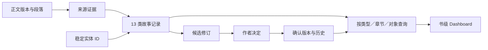

# 书级故事资料 v1 与前 20 章提取实验

本轮完成数据契约、书内存储、候选提取与书级 Dashboard 接入。没有新增 AgentTeams 插件。字段规范见 [数据契约](story-data-contract-v1.md)，入口与复现见 [使用说明](story-data-operations.md)。

## 交付结果

样例书「放开那个女巫 · 前100章续写实验」的前 20 章整理为 390 条候选。13 类契约中 11 类有结果；规划与作者要求为零，因为本次没有作者提供的正式规划输入。742 个非空段落全部作为对应章节的输入，来源最长段落为 197 字。覆盖状态按 partial 登记，不声称完整召回。

| 类型 | 条数 | 类型 | 条数 |
| --- | ---: | --- | ---: |
| 实体 | 29 | 世界规则 | 4 |
| 场景 | 30 | 事件 | 67 |
| 状态 | 38 | 关系 | 15 |
| 人物认知 | 55 | 读者揭示 | 40 |
| 情节线索 | 28 | 人物侧写 | 24 |
| 分析与概括 | 60 | 规划／作者要求 | 0 |

每书继续使用 `.literarygiant/story.sqlite3`，新增五张 `lg_story_data_*` 表。稳定记录身份与不可变修订分开，候选头与确认头分开；正文来源、事件时间、编辑修订也分开。更新需匹配预期版本，失败批次整批回滚。历史按实际追加顺序读取，来源变化与显式依赖变化可提示复核。

实际书中所有 390 条仍为 candidate，未修改正文、旧事实、规划或 Canonical。发布前保留数据库和 manifest 备份，发布后所有原有表的行数及内容摘要一致，SQLite integrity_check 为 ok。

## 模型实验与费用

首次请求前已冻结 Schema、逻辑校验器、字段说明和初始提示词；交付时重新核对哈希一致。输入仅为当前章节和之前登记的实体名录，不向模型提供后续正文。请求、响应、用量、无效批次、补修及人工处理均保留。

本次是逐步修正的工程预实验，不是同题随机对照：

- 第 1–2 章：Flash／提示词 v1。模型抄写引文、填写完整时间对象。
- 第 3 章：Flash／v2，增加时间与引文示例。
- 第 4 章先试 Flash／v3，两次仍未完整通过；这些输出没有入库。
- 第 4–20 章最终使用 V4 Pro／v4。模型选择证据段落，由宿主保存原文；时间类型由 all_time 和事件锚点确定。每章优先少量高价值记录，随后仍执行完整存储契约校验。

两种模型均显式关闭思考模式。v1–v4、传输协议、模型配置和原始请求分别留存。本轮独立脚本用量保存在书内实验账本，不自动写入 DSH 原生会话用量图。没有运行真实 DSH 成员 Agent；这批脚本用于数据与提示词预实验，不能作为已验收 Agent 协作的证据。

共 35 次请求尝试：34 份模型响应、1 次网络连接失败。按每次响应 usage、官方峰值未命中输入／输出价格计算，已知用量保守估算为 **7.053543 CNY**；失败请求仍保留 **0.423012 CNY** 的最坏预留，总预算占用上界 **7.476555 CNY**，低于授权的 10 CNY。缓存与低峰折扣未用于扩大预算，这不是供应商实际账单。Flash 峰值输入／输出单价为 2／8，V4 Pro 为 9／27 元每百万 Token。[DeepSeek 官方价格](https://api-docs.deepseek.com/zh-cn/quick_start/pricing/)

模型调用已结束。本轮额度不自动延续到下一项任务。

## 失败与人工处理

只有第 8、9、11、12、15、16、18 章各用一份模型响应完成；其他章节出现补修或前期试验失败。第 1、2、3、19 章的最终批次有明确记录的人工处理，主要包括范围枚举、原文引号、错误关联和场景证据选择。第 4 章也保留了一份未通过的人工修正尝试，最终入库采用后来的 Pro 输出。

校验实际拦截过：不存在的实体／事件 ID、错误枚举、未声明字段、缺少字段、场景被误当成事件锚点、非事件的 before 关系、超过 16 段的证据及重写原文引号。没有静默丢弃坏记录后声明整章成功。成功响应可以在本地复用，未知网络结果不自动重试。

这些结果支持“契约、反馈和候选保护发挥了作用”，不支持“提示词已经稳定可无人审核运行”。模型和提示词同时发生变化，也不能把改善单独归因于 Pro 或某条提示。

## 语义抽查与未解决项

下列为助手的来源抽查，不是作者验收、盲评或完整准确率评估。问题保留在候选中，未代作者确认。

| 记录 | 观察 | 后续处理 |
| --- | --- | --- |
| entity:witch-prisoner、ch07-entity-anna | 未命名女巫与安娜分成两个实体 | 提议有证据、可回退的身份／别名合并 |
| ch09-knowledge-beast-threat | 获知方式填 experience，引文却引用猎户说法 | 复核为 told |
| ch09-portrait-kart-caution | 对行为的“谨慎负责”解释被标为 text | 复核为 inference |
| entity:cheng-yan | 档案汇集多个细节，两处短引文不足以分别支撑 | 补充来源或拆分描述 |
| ch07-world_rule-002 | 是人物对世界的说法，basis 已标 character_statement | 不可作为已证实世界事实注入上下文 |

24 条侧写中有 15 条 basis=text，需要逐项判断是否把解释写成了直接事实；不能据此认定 15 条全部错误。38 条状态中只有一条 previous_record 关联，表明当前实验主要完成逐章登记，跨章状态连续性还很薄弱。

来源校验只证明正文版本、段落及引文存在。它不证明论断充分成立、不保证没有遗漏，也不能排除模型使用训练时见过的原著知识。已完结公开作品不适合单独证明无后文污染或原创续写质量。尚未进行完整人物认知投影、跨章实体归并、隐含依赖分析、百万字压力测试或文学质量验收。

下一轮应先处理实体解析、增量状态关联、basis／获知方式的语义审读，并把失败样例固定为回归。实验提示词是迭代叠加的版本，不能直接当作成熟 Agent 系统提示词发布。

## Dashboard 与验证

书级概览下新增「故事资料」，沿用已有 Context 风格。可按 13 类、对象、正文截止范围、关键词和分页查看，展开来源、关联及修订历史。空的规划与作者要求有明确说明。来源失效不会继续显示“引文位置已校验”。

人物／读者受限查询仅返回对应的已确认有效记录，章节目录也按截止范围截断。它仍不是执行权限边界；未来工具必须从可信任务绑定身份与范围。

隔离副本先验证，再应用主项目。最终书库／Dashboard 相关 Node 回归 **106/106**，离线费用与恢复测试 **3/3**，Dashboard 构建通过。真实 DSH 源码 CLI 的独立 profile 加载主项目插件和实际样例书，验证类别、分页、第 20 章来源、历史、截止范围、空规划、390px 内容栏及深色主题，无页面 JavaScript 错误。13 类完整字段另用合成书验证。

日常桌面 profile 的 lg-books、lg-dashboard 均链接到本仓库源码。重启 LiteraryGiant 后，从 Bookshelf 打开样例书即可查看。没有重启作者日常 App、替换其 profile 或重新打包 DMG。

## 档案位置

实际样例书 `.literarygiant/experiments/story-data-20261111/` 保存冻结清单、各提示阶段／传输配置、请求与响应、预算 JSONL、语义抽查、有效批次、发布回执及旧库备份。`summary.json` 为本轮统计，`semantic-review.json` 为待复核项，`publication-through-20.json` 为旧表不变与完整性证据。

这些包含作品内容的档案保留在作品目录，不加入代码 Git。代码未提交或推送；原工作树与 LiteraryAgent 子仓库的已有改动保留。
