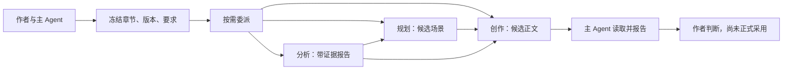

# Agent Teams 初版：真实协作、消融与交付状态（2026-11-11）

已安装到日常 LiteraryGiant App（现共 24 个插件），并实际点击验证三职责 Prompt／方法草稿、角色用量和完整候选；样例书 390 条资料中的人物、认知与情节梗概可展开。主项目 34 项相关回归、侧栏 133 项针对性测试及构建通过。真实请求最终 100/100（隔离实验 93＋日常验证 7），无剩余额度；v2.1 一个三职责案例交付 640 汉字。协作机制可运行，文学质量优势尚未证明。

## 可审查实现

- [职责、接口与配置](../../dsh-plugins/lg-agent-teams/README.md)
- [主 Agent Prompt](../../dsh-plugins/lg-agent-teams/prompts/coordinator.md)
- [分析 Prompt](../../dsh-plugins/lg-agent-teams/prompts/analysis.md)、[方法草稿](../../dsh-plugins/lg-agent-teams/methods/analysis.md)
- [规划 Prompt](../../dsh-plugins/lg-agent-teams/prompts/planning.md)、[方法草稿](../../dsh-plugins/lg-agent-teams/methods/planning.md)
- [创作 Prompt](../../dsh-plugins/lg-agent-teams/prompts/writing.md)、[方法草稿](../../dsh-plugins/lg-agent-teams/methods/writing.md)
- [机器可读验证](verification.json)、[当前源码摘要](source-hashes.json)

任务由主 Agent 决定是否委派；独立成员使用 DSH 原生 startActivation，完成后原生通知主 Agent。上下文和制品通过有范围的文学工具交接。复用 AgentTeams 的职责/任务/成员/制品思路，未继续叠加旧插件的兼容调度器，也未修改 DSH Core。

Dashboard 的两个模块读取独立只读服务：角色清单能展开 Prompt 和方法草稿；用量按实际 session 归属列出主 Agent、分析、规划、创作的请求、输入、输出与占比。任务可展开全文、来源版本和程序字数。实验任务单独标注；书级故事资料仍来自 lg-books 的 13 类数据，没有把协作摘要冒充正式人物状态。

## 真实实验

使用同一本样例小说的 SQLite 隔离备份，第一题只读第 1 章，第二题只读第 2、3 章；两题均要求 500—700 汉字、不泄露人物不知的身份、不增加未建立的能力、不采用正文。所有真实调用固定 DSH DeepSeek 账号、deepseek-flash、reasoning off、maxTokens 6000、HTTP 自动重试 0。主 Agent 和成员共同使用一个持久账本，上限 100。

| 版本／题目 | 方式 | 模型请求 | 结果 | 正文汉字 |
|---|---|---:|---|---:|
| v1／1 首次 | 三职责＋方法 | 10 | 分析失败：段落切分错误 | — |
| v1／1 修复后 | 三职责＋方法 | 14 | 协作完成，长度未通过 | 421 |
| v1／1 | 三职责、无方法 | 10 | 规划工具 JSON 无效 | — |
| v1／1 手动复验 | 三职责、无方法 | 14 | 协作完成；正文混入说明，字段长度未通过 | text 字段 1199；纯正文 675 |
| v1／1 | 直接创作 | 6 | 候选完成，长度未通过 | 719 |
| v1／2 | 三职责＋方法 | 10 | 规划工具 JSON 无效 | — |
| v2／2 | 三职责＋方法 | 14 | 规划字段与数组上限修补失败 | — |
| v2.1／2 | 三职责＋方法 | 15 | 完整协作与长度检查通过 | 640 |

**最终累计 100 / 100 次：上述隔离实验 93 次，日常 App 验证 7 次；剩余 0 次。** 计数来自请求前持久预留的账本，不使用探针日志行数：有两次探针记录了尝试，但随后被成员额度守卫拦住，没有发到模型。失败请求仍计额度；两次失败没有完整 Token 用量。没有付费裁判。

v2.1 最终通过的规划曾漏 tradeoffs，工具准确报告缺字段并要求重交完整对象，下一次提交成功。创作正文实测 640 汉字；新增矿难线索保留为作者待决，没有自动变成原作事实。

## 已修复和仍需判断

1. 第一版把无空行排版的章节当一个段落；现与书级故事资料统一为非空行，原文段落及引文测试通过。
2. 结束工具调用须在 execute 内调用原生 concludeTurn；避免重复提交或忙轮询。
3. 规划默认只给一个方案，明确数量和完整 JSON 字段；数组过长与缺字段分开反馈。
4. 程序检查 Unicode Han 数量，不相信模型自报字数；证据核对绑定真实版本。
5. 正文／相关故事资料变化后旧来源拒绝继续提交；工具守卫阻止成员用 shell 绕过候选边界；中断不会自动重试收费。

实验尚不能证明“方法草稿更好”或“集群文学质量更高”。v1 有方法候选正文为 421 字，直接创作为 719 字；无方法稿的 text 字段为 1199 字，但去掉显式标题、写作取舍及新增设想后，纯正文为 675 字，满足长度范围。其问题是说明混入正文交付字段，不能记成纯正文长度失败。三角色约 14 次请求而直接创作 6 次；费用、文字质量和协作收益不能据此混为一谈。v2.1 只有一个完整通过案例，且没有在修复后的同一版本重跑各对照组；没有作者盲评、长篇连续实验或跨模型验证。证据逐字校验不代表分析结论正确；模型预训练的后文记忆也无法由范围工具消除。

统计更正：作者质疑有效性后，重新核对原始任务 task-996e7090-5f35-4dd5-9e2c-ff8af87c3557 的 artifact.text，按其显式“《写作中做的取舍》”分界并移除自报字数标题，使用 Unicode Script=Han 计数得到 675。保留原始 1199 与字段检查结果；人工分段只用于本次审计，不代表产品已自动可靠地分离正文与说明。此前“三种方式均违反正文长度”的结论撤回。现有记录应视为开发排错与探索性比较，尚未完成文学有效性验收。

## 复现证据与安装记录

私有实验根为 LitIsLand/audits/lg-agent-teams-20261111，包含 runs（输入/响应/工具结果/候选）、sessions（原生会话）、paid-state（统一额度账本）、releases/v1（旧源码）、web-verification.json、review-results.md 和主项目改动前的 Dashboard 备份。路径按本机 LitIsLand 根解析；小说及凭据不随代码上传。真实实验驱动 live.mjs 目前是本机开发脚本，不是新的产品 Runtime。

免费验证命令在插件 README。真实网页宿主检查已通过未认证 401、角色 Prompt、93 次用量、占比和为 1、作品过滤、完整 640 字候选及来源有效；书级人物认知返回 55 条。它们是服务入口证据，不是桌面点击证据。

日常 App 已经通过自带 CLI 离线安装本仓库 lg-agent-teams 链接；既有 93 次 paid-state 一致性备份转入 desktop profile 的 lg-agent-teams/teams.sqlite3，原实验账本关闭，保持同一 author-100-20261111 预算与 100 上限。DeepSeek 账号适配器 maxRetries=0。主会话采用 DeepSeek-V4.1-Flash 1017（deepseek-account/deepseek-flash）、reasoning off；成员仍 maxTokens 6000。未重置额度。

本批没有删除文件、提交或推送，也没有修改 Projects 正文、Library 或旧 Core；基础侧栏仅增加下述投影兼容修复。

## 安装链路补验（同日，零付费请求）

应用自带 CLI 在全新隔离 Web profile 中离线安装 lg-agent-teams、lg-books 和 lg-dashboard 成功。用安装后的 App Runtime 启动此 profile，验证默认状态目录、角色／用量／候选 API、来源和鉴权。测试使用已关闭额度的账本副本，不改变真实 93 次账本。

随后将日常 23 个既有插件加载到同一隔离 profile，通过测试专用适配器跑完整三职责链路。最终 15 次免费请求（含 1 次自动标题请求）全部归入账本，三个成员均完成，工具错误为 0，角色 Prompt 和成员工具范围保持正确。初次失败源于测试驱动误将同 session 的标题请求推进成主 Agent 的下一步；修正替身后通过，未为此修改产品逻辑。非替身模型路由被测试守卫拒绝。

只核对了日常 home 存在 DSH DeepSeek 账号记录、记录类型及官方 issuer，未输出凭据值；账号的在线有效性仍需日常安装后的有界调用确认。当时日常 App 锁屏；随后解锁，实际安装与界面验收已完成，见下。

## 日常 App 实测与最终收口

2026-11-11 14:19—14:20，在日常样例书新建《第1章罗兰认知差异分析》会话，要求只读第 1 章、只派一名分析成员、不规划／续写／采用。主 Agent 固定来源、委派；成员读取有限上下文并提交，自动回报唤醒主 Agent，主 Agent 读取完整结果并显示。新增实际请求为主 Agent 5（含标题 1）、分析 2，共 7；全部完成，0 待结算。累计角色请求：主 Agent 55、分析 20、规划 17、创作 8；失败仍是此前的 2 次，SQLite integrity_check 为 ok。

界面实际点击验证：

- Bookshelf → 主 Dashboard：三种职责及 Prompt／方法可展开；请求、输入／输出、占比与 100/100 额度可见；18 个任务可打开全文与来源。
- 样例书 → 故事资料：390 条、20 个来源章、11 个非空分类；安娜档案、原文依据，以及情节梗概可展开。29 实体、55 认知、24 侧写、60 梗概／分析是候选记录数，不是已确认事实数。
- 会话 → Tasks：新版宿主 agentTeam 不再含 members，原侧栏抛 map 异常。按当前 task-only 投影处理后，原生 subagentCatalog 仍展示主 Agent → 文学分析关系；隔离 133 项侧栏测试和客户端构建通过，重开日常 App 后验证可见。

实测同时暴露：分析成员提交了两处引文，超过“1 处”的要求；主 Agent 用改名解释回避这一差异，并把实际 7 次模型请求误报成 3 次。不能把此次机制完成标为完全服从作者要求。保留原始会话；已为 lg_team_result 增加含主／成员／标题的账本快照，Prompt 要求明确快照时点、不自估用量、如实报告或注明节选。新增回归覆盖标题、失败与跨会话归属；主项目 34 项相关测试通过。此项修正只做免费验证，未超 100 次再次调用模型。

任务列表折叠标题缩短到 80 字，展开保留完整任务目标；UI 重新验证。最终报告修补后的模型行为、作者盲评、长篇收益仍待下一轮明确任务与预算。当前预算耗尽，继续点击新模型任务会被持久额度守卫拒绝；不得重建账本规避上限。
